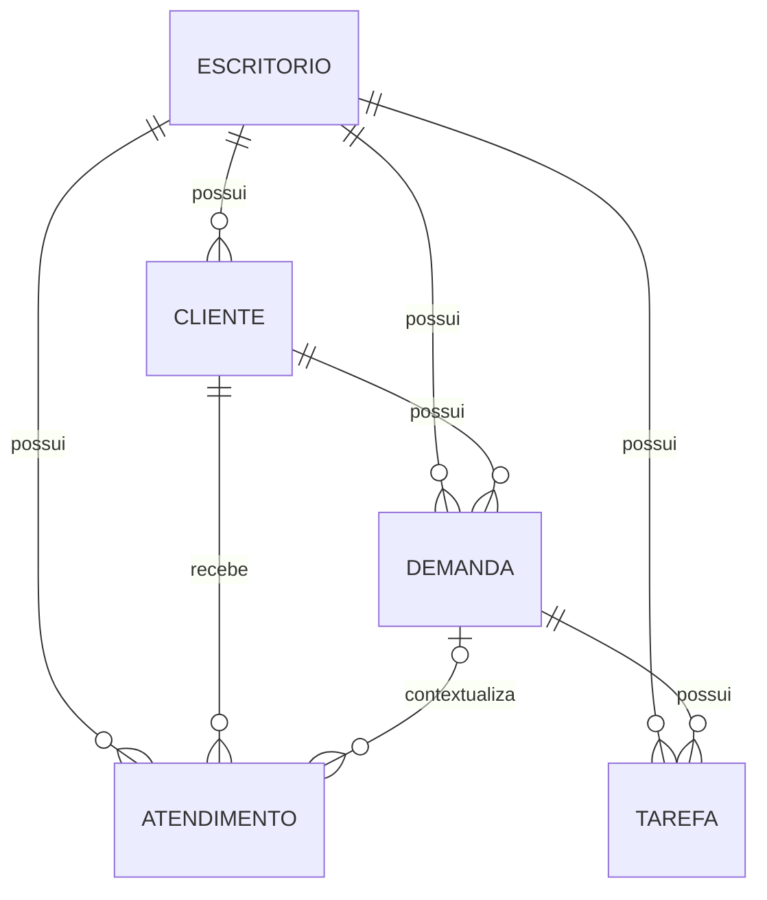
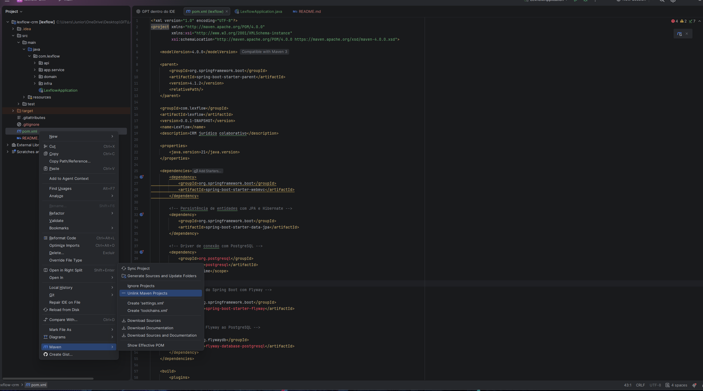
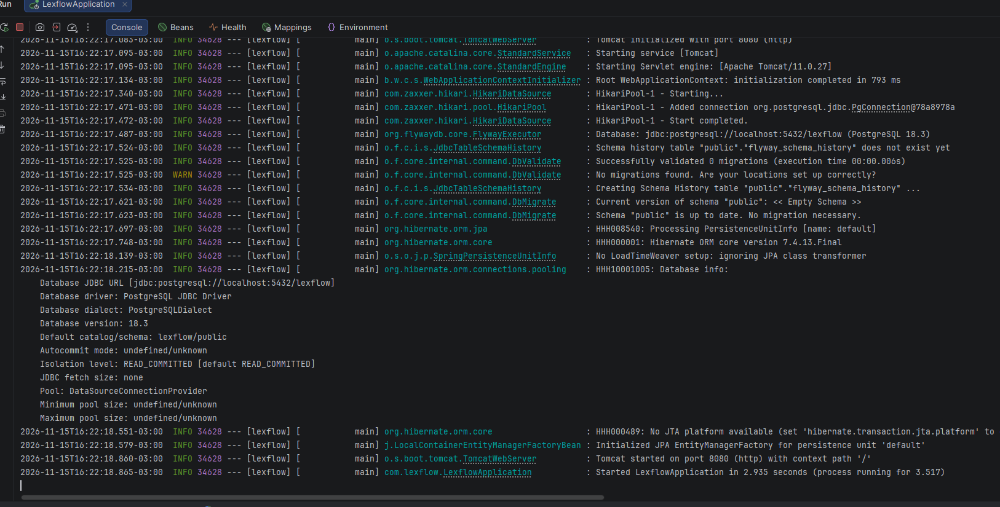
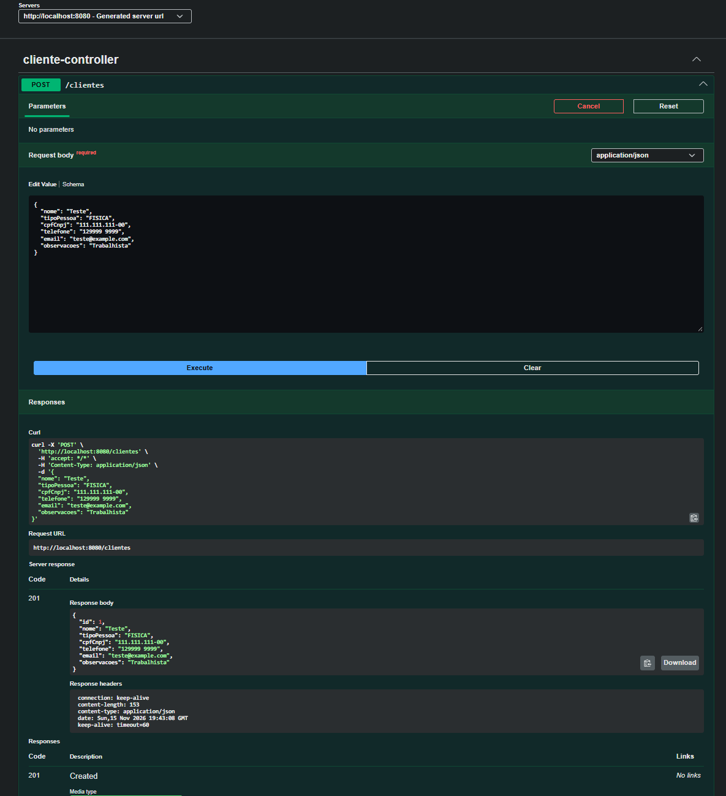
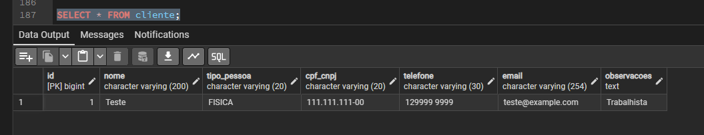
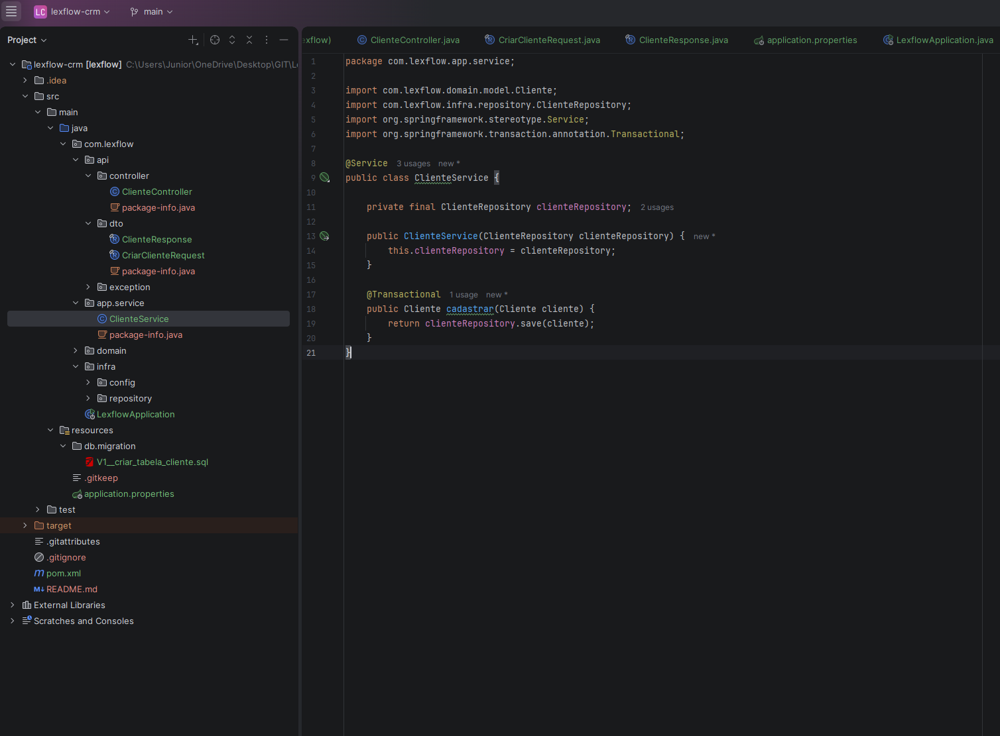
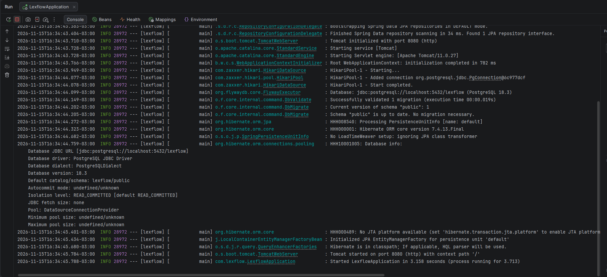
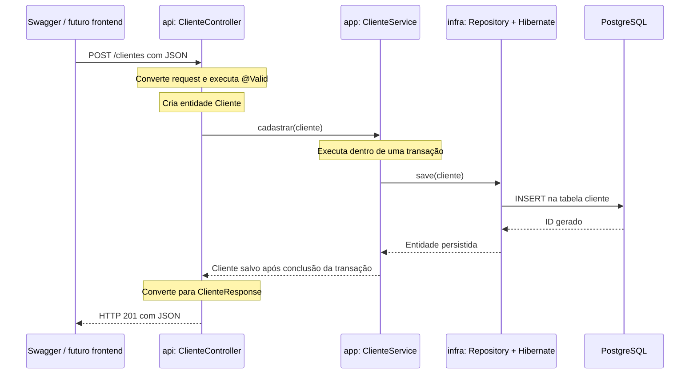
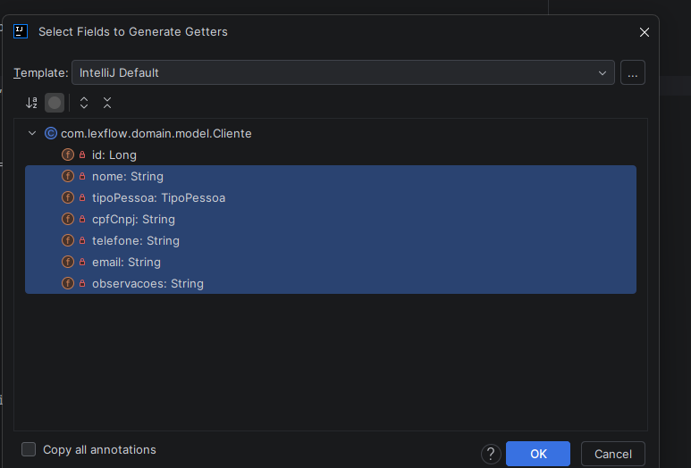
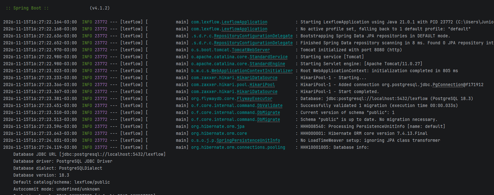

# LexFlow CRM ⚖️

CRM jurídico colaborativo para aprender desenvolvimento em equipe. O backend é um **monólito Java organizado em `domain`, `app`, `api` e `infra`**: uma aplicação, um projeto Maven e um banco PostgreSQL.

O cadastro de clientes é a primeira funcionalidade completa e serve de referência para as próximas contribuições. Este guia explica como executar o projeto e como seguir suas camadas.

**Trabalho em equipe:** as mudanças entram por branch e Pull Request para a `main`. A revisão por um colega é um acordo da equipe, sem exigência técnica de aprovação. Veja o [fluxo de contribuição abaixo](#branches-pull-requests-e-revisão) e o [guia de configuração do GitHub e CI](docs/colaboracao-e-ci.md).

**Revisão automática:** o Sourcery foi conectado ao repositório e as regras das camadas foram cadastradas no painel. Ele sugere melhorias nos PRs; os integrantes avaliam os apontamentos e continuam responsáveis pelo código.

## Índice

- [Estado atual](#estado-atual)
- [Multi-tenancy: um escritório por tenant](#multi-tenancy-um-escritório-por-tenant)
- [Branches, Pull Requests e revisão](#branches-pull-requests-e-revisão)
- [Tecnologias](#tecnologias)
- [Como executar](#como-executar)
- [Como testar](#como-testar)
- [Estrutura](#estrutura)
- [Como seguir as camadas](#como-seguir-as-camadas)
- [Fluxo completo do cadastro](#fluxo-completo-do-cadastro)
- [Validações](#validações)
- [ORM e migrations](#orm-e-migrations)
- [Roteiro para novas funcionalidades](#roteiro-para-novas-funcionalidades)
- [Problemas comuns](#problemas-comuns)
- [Próximos passos](#próximos-passos)

## Estado atual

Implementado e testado manualmente:

- Inicialização do Spring Boot com Java 21 e Maven.
- Conexão com PostgreSQL e execução de migrations pelo Flyway.
- Entidade `Cliente`, enum `TipoPessoa` e repository JPA.
- Cadastro por **POST /clientes**, com DTOs de entrada e saída.
- Swagger UI para documentação e testes.
- Resposta **201 Created**, com ID gerado, e registro conferido diretamente no banco.

Também estão incluídos dois testes de integração do cadastro e o workflow **CI Java**, que executa compilação, testes e empacotamento com PostgreSQL temporário. A execução remota começa depois de enviar o workflow ao GitHub.

**Ponto de parada:** apenas o cadastro está implementado. Busca por ID, listagem, edição, exclusão, usuários e login ainda não estão implementados. Escritorio e o isolamento multi-tenant estão planejados na issue #12; o cadastro atual ainda não separa dados por escritório. Demanda, Atendimento e Tarefa também são entidades planejadas. O frontend será desenvolvido posteriormente; React ou Angular ainda será definido.

## Multi-tenancy: um escritório por tenant

**Decisão de arquitetura, ainda não implementada:** cada escritório jurídico
será um tenant. A entidade `Escritorio` representa a organização que usa o CRM;
`Cliente` continua sendo a pessoa física ou jurídica atendida por ela.

Manteremos o monólito em camadas, com um PostgreSQL e tabelas compartilhadas.
Os registros de negócio terão `escritorio_id` para identificar seu tenant.
A primeira entrega desse modelo está na
[issue #12 — Escritorio e isolamento de clientes](https://github.com/Khallarrary/lexflow-crm/issues/12).

### Modelo inicial planejado

| Entidade | Campos ou relacionamento |
|---|---|
| Escritorio | `id` gerado pelo banco, `nome` obrigatório e `ativo` inicialmente verdadeiro |
| Cliente | Pertence obrigatoriamente a um escritório |
| Demanda | Pertence a um escritório e a um cliente desse mesmo escritório |
| Atendimento | Pertence a um escritório, com cliente e demanda opcional do mesmo escritório |
| Tarefa | Pertence a um escritório e a uma demanda dele |



O diagrama descreve o modelo de destino. Cada vínculo também deve respeitar o
mesmo escritório; as relações do diagrama, sozinhas, não garantem essa condição.

### Primeira implementação

- Criar `domain.model.Escritorio` e `infra.repository.EscritorioRepository`.
- Criar nova migration para a tabela `escritorio` e o vínculo obrigatório de `cliente`.
- Associar explicitamente os cadastros existentes a um escritório inicial, preservando IDs e dados. Não editar a V1 já aplicada.
- Ajustar CPF/CNPJ para unicidade composta por `(escritorio_id, cpf_cnpj)`. O mesmo documento pode existir em escritórios diferentes.
- Implementar o contexto do escritório atual e restringir consultas, gravações e verificações de duplicidade a ele.
- Testar com dois escritórios para comprovar o isolamento.

Não é necessário um CRUD público de escritórios nesta primeira entrega. O
escritório inicial pode ser preparado pelo fluxo controlado de configuração.

### Isolamento e contexto do escritório

**Adicionar uma entidade e uma FK não conclui o multi-tenancy.** Buscar somente
pelo ID sem aplicar o escritório, listar sem filtro ou aceitar um vínculo com
registro de outro tenant pode expor ou misturar dados.

A implementação deve garantir:

- O escritório é determinado pelo contexto confiável do backend; o consumidor não escolhe nem altera o tenant no corpo do cadastro.
- Ausência de contexto, escritório inválido ou inativo impede a operação; não resulta em uma consulta global.
- Busca por ID, paginação, atualização e duplicidade respeitam o tenant atual.
- Demanda, Atendimento e Tarefa não podem se relacionar com registros de outro escritório, com constraints de banco que reforcem essa integridade.
- O contexto não vaza ao reutilizar threads ou conexões entre operações.
- Testes usam pelo menos dois escritórios, incluindo tentativas de acessar ou alterar dados do outro.

### Desenvolvimento sem login e acesso real

Enquanto não houver autenticação, usar um **escritório fixo configurado no
servidor, exclusivamente em perfil local/dev**. O mecanismo e as propriedades
serão definidos na issue #12; o projeto atual ainda não oferece essa configuração.
Os testes poderão estabelecer contextos de escritórios distintos de forma
controlada, sem criar um mecanismo público para trocar de tenant.

Antes de disponibilizar acesso real a vários escritórios, implementar login e
verificar o vínculo do usuário com o escritório selecionado. Um `tenantId` em
header, URL ou JSON não é, por si só, autorização para acessar aquele escritório.
O modo local sem login não deve ser tratado como isolamento seguro para usuários
externos.

### Ordem do backlog

Priorizar a base da [issue #12](https://github.com/Khallarrary/lexflow-crm/issues/12)
antes de integrar as evoluções de clientes (#4 a #7) e as entidades seguintes
(#8 a #10). Tratamento de erros e Maven Wrapper podem avançar em paralelo,
combinando os pontos de integração com essa base.

## Branches, Pull Requests e revisão

O objetivo é praticar o trabalho em equipe sem concentrar as aprovações ou os
merges no proprietário do repositório.

```text
Issue → branch de trabalho → commits → push da branch → PR para main
      → CI + sugestões do Sourcery + revisão combinada com um colega → merge
```

### O que é bloqueio técnico e o que é acordo da equipe

| Item | Como funciona |
|---|---|
| Push direto na main | Bloqueado pelo ruleset; use uma branch e um PR |
| Aprovação de colega | Acordo da equipe: peça e aguarde a revisão, mas o ruleset deve exigir 0 aprovações |
| Aprovar o próprio PR | O GitHub não permite essa ação, mesmo com 0 aprovações exigidas |
| Fazer merge do próprio PR | Permitido a quem tem escrita, desde que os demais requisitos do repositório estejam satisfeitos |
| Aprovação automática do Sourcery | Deve ficar desativada; o bot auxilia com análise e comentários |
| Check build-e-testes | Executa build e testes; só bloqueia merge quando adicionado como obrigatório ao ruleset |

**Aprovar não é fazer merge.** Aprovar registra o parecer de quem revisou o
código. Fazer merge integra os commits na branch de destino. Com zero aprovações
exigidas, o autor pode integrar seu próprio PR sem uma aprovação formal; o acordo
de pedir revisão e discutir o código do colega continua valendo para todos.

### Configuração definida para a main

Em **Settings → Rules → Rulesets → protecao-main**, mantenha a regra ativa,
direcionada à `main`, com bypass vazio. A exigência de PR continua marcada.
Use **Required approvals = 0** e desmarque **Require approval of the most recent
reviewable push**. **Dismiss stale pull request approvals** também fica desmarcado.
Não exija aprovação de Code Owners ou de times específicos nesse fluxo.

Mantenha bloqueios de force push e exclusão da main. **Restrict updates** deve
ficar desmarcado: exigir PR já controla a entrada das mudanças. A resolução de
conversas permanece uma condição separada da quantidade de aprovações.

O ruleset foi criado inicialmente com uma aprovação obrigatória. **Se ainda
estiver assim no GitHub, ajuste essas opções e salve:** atualizar este README
não modifica as configurações remotas. A última configuração com zero aprovações
precisa ser conferida no painel.

Quando a CI executar pela primeira vez, adicione **build-e-testes** em **Require
status checks to pass**. O workflow existir ou executar não torna o check
obrigatório automaticamente. O Sourcery também não libera o merge por conta
própria: regras de conversas, CI e demais condições continuam independentes.

### Sourcery no dia a dia

O Sourcery revisa PRs e comenta possíveis melhorias de código, arquitetura e
migrations. Suas configurações ficam no painel do serviço, em **Repo settings**:
revisão habilitada, português, perfil Balanced e aprovação automática desativada.
As regras personalizadas seguem as responsabilidades das camadas descritas neste
README. Para alterações nessas regras, use **Review rules** no painel.

Ao abrir um PR pronto para revisão, confira se o bot publicou sua análise. Se
precisar solicitar uma nova revisão, comente no PR:

```text
@sourcery-ai review
```

Avalie as sugestões antes de aplicá-las. A análise automática pode errar e não
substitui os testes nem a revisão combinada com um colega. Para repositórios
privados, confira o plano contratado ou o período de teste no serviço.

### Passo a passo no GitHub Desktop

1. Antes de começar, atualize a main local e crie uma branch em **Branch → New branch**.
2. Use um nome descritivo, como `feat/cadastro-demanda` ou `ci/configurar-esteira`.
3. Faça as alterações e os commits nessa branch.
4. Clique em **Publish branch** no primeiro envio, ou **Push origin** nos seguintes.
5. Use **Create Pull Request**, com sua branch como origem e `main` como destino.
6. Descreva o que mudou e como foi testado. Solicite revisão de outro integrante.
7. Confira a CI e as sugestões do Sourcery. Converse com o colega e aplique as correções necessárias.
8. Faça o merge quando o trabalho estiver pronto e os requisitos técnicos estiverem satisfeitos, seguindo o acordo de revisão da equipe.

Colaboradores com escrita podem revisar e fazer merge; não precisam receber
acesso administrativo. O autor pode fazer o merge depois desse processo, sem
precisar ser o proprietário do repositório.

### Se você já commitou na main e o push foi recusado

A mensagem **Changes must be made through a pull request** indica que a proteção
funcionou. O commit permanece salvo localmente.

No GitHub Desktop, crie uma nova branch **a partir da main local atual**, que
contém o commit pendente. Publique essa branch e abra o PR. Não é necessário
refazer o commit, usar force push ou desativar a proteção. Se houver outros
commits locais pendentes, eles também estarão na branch; confira o diff do PR.

A proteção é aplicada no GitHub: ela não impede editar arquivos ou criar commits
na main local. Por isso, criar a branch antes de trabalhar continua sendo o
hábito recomendado.

## Tecnologias

As versões estão no [pom.xml](pom.xml).

| Tecnologia | Função |
|---|---|
| Java 21 | Linguagem e execução |
| Maven | Dependências, compilação e empacotamento |
| Spring Boot 4.1.2 | Configuração e inicialização |
| Spring Web MVC | Endpoints HTTP e respostas JSON |
| Spring Data JPA + Hibernate | Mapeamento e persistência dos objetos |
| PostgreSQL | Banco relacional; os prints registram a versão 18.3 |
| Flyway | Versionamento da estrutura do banco |
| Jakarta Validation | Validação dos dados recebidos |
| springdoc-openapi 3.2.0 | OpenAPI e Swagger UI |

O `spring-boot-starter-parent` gerencia as versões das dependências associadas ao Spring Boot. A versão do springdoc está declarada explicitamente. Evite alterar versões isoladas sem conferir a compatibilidade.

## Como executar

### 1. Preparar o ambiente

Instale Git, **JDK 21** e PostgreSQL. O passo a passo usa IntelliJ IDEA e pgAdmin; o pgAdmin é opcional.

Confira no terminal:

```powershell
java -version
javac -version
```

Ambos devem indicar Java 21. No IntelliJ, confira também o **Project SDK** em **File → Project Structure → Project** e o JDK usado na configuração de execução.

### 2. Clonar e abrir

```powershell
git clone https://github.com/Khallarrary/lexflow-crm.git
cd lexflow-crm
```

No IntelliJ, clique em **Open** e selecione a pasta que contém o `pom.xml`. Se solicitado, carregue o projeto Maven. Para baixar ou atualizar dependências, salve o POM e use botão direito em `pom.xml` → **Maven → Sync Project**. Em outras versões, pode aparecer **Reload Project**.

A raiz contém `pom.xml`, `README.md` e `src` no mesmo nível. Não crie outro projeto dentro dessa pasta.

<details>
<summary>Imagem: sincronização do Maven</summary>



</details>

### 3. Criar o banco vazio

No pgAdmin: conecte ao servidor → botão direito em **Databases → Create → Database** → nome `lexflow` → escolha seu usuário como proprietário → **Save**.

Como alternativa, conectado a um banco existente, como `postgres`, execute:

```sql
CREATE DATABASE lexflow;
```

Escolha apenas um dos caminhos. O usuário da aplicação precisa conseguir conectar e criar objetos no schema `public` desse banco. **Não crie a tabela cliente manualmente:** a migration fará isso.

### 4. Conferir a configuração

O [application.properties](src/main/resources/application.properties) contém:

```properties
spring.application.name=lexflow

spring.datasource.url=jdbc:postgresql://localhost:5432/lexflow
spring.datasource.username=${DB_USERNAME}
spring.datasource.password=${DB_PASSWORD}

spring.jpa.hibernate.ddl-auto=validate
spring.jpa.open-in-view=false

spring.flyway.enabled=true
```

| Configuração | Significado |
|---|---|
| `localhost:5432/lexflow` | Banco local chamado lexflow; ajuste a porta se necessário |
| `${DB_USERNAME}` e `${DB_PASSWORD}` | Credenciais recebidas por variáveis de ambiente |
| `ddl-auto=validate` | Hibernate confere o mapeamento sem criar ou alterar tabelas |
| `open-in-view=false` | Não mantém o contexto de persistência aberto por toda a requisição web; coordenamos a persistência nos services |
| `flyway.enabled=true` | Habilita migrations na inicialização |

### 5. Configurar as variáveis no IntelliJ

1. Abra `LexflowApplication` e execute uma vez pelo triângulo verde ao lado de `main` para criar a configuração. Se as credenciais ainda não estiverem definidas, essa tentativa pode falhar.
2. Acesse **Run → Edit Configurations** e selecione **LexflowApplication**.
3. Clique em **Modify options → Environment variables**, se o campo estiver oculto.
4. Abra o editor do campo e adicione uma linha para cada variável:

| Nome | Valor |
|---|---|
| `DB_USERNAME` | Seu usuário PostgreSQL, por exemplo `postgres` |
| `DB_PASSWORD` | Sua senha local |

5. Confirme com **OK** nas duas janelas.

No editor em tabela, cada variável ocupa uma linha. No campo de texto único do IntelliJ, as variáveis são separadas por ponto e vírgula.

Não grave senhas no código ou em configurações compartilhadas. Não é necessário marcar **Store as project file**. **Um arquivo .env não é carregado automaticamente pela configuração atual**; use variáveis da configuração de execução ou do processo do terminal.

### 6. Executar e reiniciar

Execute `LexflowApplication` por **Run ▶**. Para reiniciar, clique em **Stop ■** e depois em **Run ▶**.

A classe principal fica em `com.lexflow`. Com `@SpringBootApplication`, o Spring encontra componentes, entidades e repositories nos subpacotes. O método `main` chama `SpringApplication.run(...)` para iniciar o sistema.

Com banco vazio, o Flyway aplica a V1 e cria seu histórico. Depois, executa apenas migrations pendentes. Ao final, procure:

```text
Tomcat started on port 8080
Started LexflowApplication
```

<details>
<summary>Imagem: conexão com PostgreSQL e inicialização do Flyway</summary>



Este print foi feito antes da primeira migration; o aviso de ausência de migrations era esperado naquele momento.

</details>

### Alternativa pelo terminal

**Ainda não há Maven Wrapper** (`mvnw` ou `mvnw.cmd`) no repositório. Fora do IntelliJ, instale Maven 3.6.3 ou superior e confira `mvn -version`. O IntelliJ também permite executar objetivos pelo Maven integrado.

No PowerShell, na pasta do `pom.xml`:

```powershell
$env:DB_USERNAME = 'postgres'
$env:DB_PASSWORD = 'substitua_pela_sua_senha_local'
mvn spring-boot:run
```

As variáveis valem para esse processo. As configurações de execução do IntelliJ não são automaticamente compartilhadas com um terminal independente.

## Como testar

Com a aplicação rodando, abra o [Swagger UI local](http://localhost:8080/swagger-ui.html). A especificação JSON está em [OpenAPI local](http://localhost:8080/v3/api-docs).

1. Expanda **POST /clientes**.
2. Clique em **Try it out**.
3. Cole o JSON abaixo.
4. Clique em **Execute**.

```json
{
  "nome": "Cliente de Teste",
  "tipoPessoa": "FISICA",
  "cpfCnpj": null,
  "telefone": "11999999999",
  "email": "cliente@example.com",
  "observacoes": "Primeiro cadastro pela API"
}
```

O retorno esperado é **201 Created**, com os dados e o ID gerado. O ID depende dos registros anteriores; não precisa ser 1 nem formar uma sequência sem lacunas.



No Query Tool do pgAdmin, conectado ao banco `lexflow`, execute:

```sql
SELECT * FROM cliente;
```



Os prints registram o teste manual da primeira entrega. O CPF da demonstração foi aceito como texto; isso não indica que seus dígitos verificadores tenham sido validados.

Para verificar a validação de entrada, teste também nome só com espaços, ausência de `tipoPessoa` e e-mail com formato inválido. O resultado esperado é **400**. Esses casos são um roteiro para reprodução: os prints comprovam o cadastro bem-sucedido, não a execução de todos os cenários.

## Estrutura

```text
lexflow-crm/
├── pom.xml
├── README.md
├── docs/images/
└── src/
    ├── main/
    │   ├── java/com/lexflow/
    │   │   ├── LexflowApplication.java
    │   │   ├── domain/
    │   │   │   ├── model/Cliente.java
    │   │   │   └── enums/TipoPessoa.java
    │   │   ├── app/
    │   │   │   └── service/ClienteService.java
    │   │   ├── api/
    │   │   │   ├── controller/ClienteController.java
    │   │   │   ├── dto/
    │   │   │   │   ├── CriarClienteRequest.java
    │   │   │   │   └── ClienteResponse.java
    │   │   │   └── exception/
    │   │   └── infra/
    │   │       ├── repository/ClienteRepository.java
    │   │       └── config/
    │   └── resources/
    │       ├── application.properties
    │       └── db/migration/V1__criar_tabela_cliente.sql
    └── test/java/com/lexflow/
```

`api.exception` e `infra.config` estão reservados para implementações futuras. Os `package-info.java` documentam os pacotes. `src/test` contém `ClienteCadastroTest` e a configuração do banco exclusivo de testes. `target` é gerada pelo Maven e não deve ser versionada. O workflow fica em `.github/workflows/ci.yml` e o modelo de PR em `.github/pull_request_template.md`.

<details>
<summary>Imagem: estrutura no IntelliJ e service atual</summary>



O IntelliJ pode compactar os pacotes e mostrar `app.service` ou `db.migration`; correspondem às pastas aninhadas `app/service` e `db/migration`.

</details>

## Como seguir as camadas

### domain: conceitos e regras do negócio

Contém [Cliente](src/main/java/com/lexflow/domain/model/Cliente.java) e [TipoPessoa](src/main/java/com/lexflow/domain/enums/TipoPessoa.java).

- A entidade reúne atributos e, conforme o negócio evoluir, comportamentos que mantêm seu estado válido.
- O enum representa o conjunto fixo `FISICA` e `JURIDICA`.
- Regras essenciais devem valer mesmo fora de uma chamada HTTP; não dependa apenas do DTO para proteger o domínio.
- O domínio não conhece controllers, DTOs, services ou repositories das outras camadas do projeto.

**Decisão adotada:** a entidade de domínio também usa anotações JPA. Não temos uma segunda classe `ClienteEntity` para persistência. Nosso modelo conhece o mapeamento das tabelas; não estamos impondo um domínio totalmente isolado de frameworks.

### app: casos de uso e transações

O [ClienteService](src/main/java/com/lexflow/app/service/ClienteService.java) coordena o cadastro.

- Recebe a entidade preparada pelo controller e chama o repository.
- Define a transação com `@Transactional`.
- Deve coordenar regras que exigem consultas ou várias operações, como verificar duplicidade antes de salvar.
- Não deve importar DTOs de `api`, retornar `ResponseEntity` nem escolher códigos HTTP.

Hoje, `cadastrar` apenas chama `save`; a validação amigável de duplicidade ainda não existe. O Spring fornece a implementação do repository pelo construtor: isso é **injeção de dependência**. Não precisamos usar `new` para instanciar o repository.

Uma falha de persistência na gravação impede a conclusão bem-sucedida da transação. A resposta de sucesso só sai depois que o service conclui essa transação.

### api: contrato HTTP, entrada e saída

O [ClienteController](src/main/java/com/lexflow/api/controller/ClienteController.java) expõe HTTP. Os DTOs definem o contrato externo.

- [CriarClienteRequest](src/main/java/com/lexflow/api/dto/CriarClienteRequest.java): dados aceitos no cadastro, sem ID.
- `@RequestBody`: permite converter o JSON recebido no DTO.
- `@Valid`: executa as validações do DTO antes de entrar no método.
- O controller transforma o request em `Cliente` e chama o service.
- [ClienteResponse](src/main/java/com/lexflow/api/dto/ClienteResponse.java): define os dados devolvidos, incluindo o ID.
- `ClienteResponse.de(clienteSalvo)` faz a conversão da entidade.
- O controller retorna HTTP 201 no sucesso.
- `api.exception` será usado para traduzir erros em respostas HTTP padronizadas; por enquanto só documenta o pacote.

O controller não executa SQL, não acessa repositories e não concentra regras do negócio. Neste fluxo, os mapeamentos ficam explicitamente no controller e no DTO de resposta; ainda não há biblioteca ou pacote separado de mappers.

Os DTOs são `record`: o Java gera construtor e métodos de leitura. Usamos `request.nome()`; na entidade usamos getters, como `cliente.getNome()`.

### infra: persistência e configuração técnica

O [ClienteRepository](src/main/java/com/lexflow/infra/repository/ClienteRepository.java) estende `JpaRepository<Cliente, Long>`.

- `Cliente` é a entidade gerenciada e `Long` é o tipo de seu ID.
- Spring Data fornece `save`, `findById` e consultas paginadas, entre outros métodos.
- Não precisamos implementar manualmente essas operações.
- Consultas adicionais devem ser declaradas aqui quando necessárias.
- `infra.config` receberá configurações técnicas que precisarem de classes próprias.

O repository consulta e persiste; não retorna respostas HTTP nem recebe DTOs da API. As migrations ficam em `resources/db/migration`, onde o Flyway as encontra.

<details>
<summary>Imagem: repository reconhecido e aplicação iniciada</summary>



</details>

### Regras de dependência

| Camada | Pode usar | Evitar |
|---|---|---|
| api | Services de app, DTOs da API e modelos/enums do domínio | Repository direto, SQL e regras do negócio no controller |
| app | Domínio e repositories de infra | DTOs de api, controllers e detalhes HTTP |
| infra | Domínio e bibliotecas de persistência/configuração | Controllers e DTOs para persistir dados |
| domain | Tipos do domínio e anotações JPA adotadas | Dependências de api, app ou repositories de infra |

**Neste projeto, app depende dos repositories de infra.** É uma decisão explícita da arquitetura em camadas que escolhemos. Não criamos interface e implementação para cada service nem duplicamos o repository em outra camada. Uma nova abstração deve resolver uma necessidade concreta.

## Fluxo completo do cadastro



O diagrama descreve o fluxo de sucesso, não o instante exato de cada instrução SQL interna do Hibernate.

**Flyway não participa de cada cadastro.** Ele altera a estrutura na inicialização; JPA/Hibernate grava os clientes durante as requisições.

## Validações

| Lugar | Responsabilidade | Estado atual |
|---|---|---|
| DTO + @Valid | Formato e requisitos da entrada HTTP | Nome e tipo obrigatórios, limites de texto e formato do e-mail |
| Domínio | Regras que devem valer independentemente da entrada | Modelo inicial; invariantes de criação ainda precisam ser reforçadas |
| Service | Regras que exigem consultas e coordenação | Cadastro pronto; verificação amigável de duplicidade pendente |
| Banco | Integridade, inclusive em acessos concorrentes | PK, NOT NULL, UNIQUE e CHECK do tipo de pessoa |

Observe os limites atuais:

- As validações do DTO dependem do `@Valid` no controller. Uma chamada direta ao service não passa automaticamente por esse DTO.
- `@Column(nullable = false)` descreve o mapeamento; não substitui `@NotBlank`. O `NOT NULL` do banco também não rejeita espaços.
- CPF/CNPJ, telefone, e-mail e observações são opcionais. `@Size` e `@Email` aceitam `null`.
- CPF/CNPJ só tem limite de tamanho e unicidade do texto armazenado. **Ainda não há normalização nem validação dos dígitos verificadores.** Formas diferentes do mesmo documento podem escapar da comparação textual.
- A unicidade atual de documento é global, conforme a V1. A issue #12 deve substituí-la por unicidade por escritório; a issue #6 deve usar esse escopo ao normalizar e tratar duplicidade.
- A restrição única permite vários valores `NULL`; uma string vazia não é `NULL`.
- Uma consulta de duplicidade no service não substitui a restrição única no banco.
- Ainda não há handler próprio para duplicidade; não presuma que a API já retorna 409 nesses casos.

## ORM e migrations

Hibernate faz o mapeamento e a persistência; Flyway versiona a estrutura do banco.

### Mapeamento de Cliente

| Java | PostgreSQL | Definição |
|---|---|---|
| Long id | id | BIGINT, identity, chave primária |
| String nome | nome | VARCHAR(200), obrigatório |
| TipoPessoa tipoPessoa | tipo_pessoa | VARCHAR(20), obrigatório, FISICA ou JURIDICA |
| String cpfCnpj | cpf_cnpj | VARCHAR(20), opcional e único quando informado |
| String telefone | telefone | VARCHAR(30), opcional |
| String email | email | VARCHAR(254), opcional |
| String observacoes | observacoes | TEXT, opcional |

`@Entity` identifica a entidade; `@Table`, a tabela; `@Id`, a chave; `@GeneratedValue(IDENTITY)`, o ID gerado pelo banco. `@Enumerated(EnumType.STRING)` grava o nome do enum. O construtor vazio `protected` atende ao ORM; o público permite criar o cliente sem informar ID.

<details>
<summary>Imagem: geração dos getters no IntelliJ</summary>



Dentro da classe, use **Alt + Insert → Getter** e selecione todos os campos, incluindo `id`. Neste registro, o ID ainda estava fora da seleção; ele foi incluído antes da confirmação.

</details>

### Como seguir com migrations

1. Defina os campos e relacionamentos da funcionalidade.
2. Crie uma migration em `src/main/resources/db/migration`.
3. Use `V<numero>__<descricao>.sql`, com **dois underscores**. A primeira é `V1__criar_tabela_cliente.sql`.
4. Mantenha o mapeamento da entidade compatível com o SQL.
5. Inicie a aplicação. Flyway aplica as pendentes; Hibernate valida o mapeamento depois.
6. Confira o resultado e o histórico:

```sql
SELECT installed_rank, version, description, success
FROM flyway_schema_history
ORDER BY installed_rank;
```

**Não edite migrations já aplicadas e compartilhadas.** Mudanças futuras entram em novos arquivos, como `V2__adicionar_campo_cliente.sql`. Combine a numeração com a equipe e avalie o efeito sobre registros existentes, especialmente ao adicionar campos obrigatórios.

O Flyway registra o que já executou e verifica a integridade dos arquivos. Não use `ddl-auto=update` para alterar tabelas automaticamente junto com esse fluxo: o responsável pelas mudanças de estrutura é o Flyway.

<details>
<summary>Imagem: primeira migration validada e schema na versão 1</summary>



`No migration necessary` é esperado quando a V1 já foi aplicada e não há outra pendente.

</details>

No Entity Framework Core, gerar migrations a partir das diferenças entre o modelo atual e um snapshot é parte do fluxo integrado. Hibernate + Flyway não gera esses arquivos automaticamente a partir das entidades: escrevemos e revisamos as migrations SQL.

## Roteiro para novas funcionalidades

Use o cadastro de cliente como referência para manter a mesma organização entre as contribuições.

1. **Requisito:** registre na issue o comportamento, dados obrigatórios, erros esperados e critérios de aceite.
2. **Domínio:** crie entidades em `domain.model` e enums em `domain.enums`. Defina relacionamentos e regras que devem valer sempre.
3. **Persistência:** crie a nova migration quando o banco mudar. Crie ou estenda repositories em `infra.repository`, aproveitando os métodos JPA existentes.
4. **Caso de uso:** implemente o service em `app.service`. Coordene regras e consultas; defina a transação das operações de escrita que precisam ser atômicas.
5. **Contrato:** crie DTOs em `api.dto` para os dados aceitos e devolvidos. Inclua validações de entrada.
6. **Endpoint:** crie o controller em `api.controller`. Receba HTTP, delegue ao service e converta o resultado. Não acesse repository diretamente.
7. **Erros:** mantenha a regra separada da tradução HTTP. Handlers ficam em `api.exception`; services não dependem desses handlers.
8. **Verificação:** confira sucesso e falhas relevantes, incluindo a persistência. Testes automatizados ficam em `src/test/java`, seguindo os pacotes do código.
9. **Documentação e PR:** atualize exemplos afetados e descreva o que mudou, como reproduzir e como foi validado. Siga o fluxo de colaboração acordado pela equipe.

Exemplo futuro: cadastrar uma demanda envolverá `Demanda`, sua migration, repository, `DemandaService`, DTOs e `DemandaController`. É um roteiro, não uma lista de classes já existentes.

Antes de enviar a contribuição, confira:

- O controller chama o service e não acessa o banco diretamente?
- O service evita DTOs da API e detalhes HTTP?
- O domínio evita dependências das outras camadas do projeto?
- Mudanças nas tabelas estão em uma nova migration?
- Consultas e vínculos respeitam o escritório atual, conforme a base multi-tenant planejada?
- Contrato e erros foram documentados?
- O comportamento foi verificado e não há credenciais locais no Git?

## Problemas comuns

| Sintoma | O que conferir |
|---|---|
| Imports ficam vermelhos | Salve o POM, use Maven → Sync Project e veja erros de download |
| Placeholder DB_USERNAME/DB_PASSWORD não resolvido | Configure as variáveis na execução usada |
| Connection refused | PostgreSQL ativo, host e porta corretos |
| Password authentication failed | Usuário e senha |
| Banco lexflow não existe | Crie o banco antes da inicialização |
| Tabela ou coluna ausente na validação | Banco correto, migration executada e mapeamento compatível |
| Checksum diferente no Flyway | Investigue com a equipe se uma migration já aplicada foi alterada antes de modificar o histórico |
| Porta 8080 ocupada | Pare a instância anterior ou configure outra porta com server.port e ajuste a URL |
| Swagger só mostra POST | É o estado atual; consultas ainda não foram implementadas |
| Abrir / retorna 404 | Não há endpoint raiz; abra /swagger-ui.html |

## Próximos passos

- Priorizar Escritorio, vínculo de Cliente e isolamento por escritório — [issue #12](https://github.com/Khallarrary/lexflow-crm/issues/12).
- Busca por ID com 200 e 404.
- Listagem paginada, edição e definição da estratégia de exclusão.
- Normalização e validação de CPF/CNPJ e tratamento de duplicidade por escritório.
- Respostas de erro padronizadas.
- Ampliar os testes automatizados conforme os comportamentos evoluírem.
- Maven Wrapper para uniformizar a execução pela equipe.
- Demanda, Atendimento e Tarefa.
- Usuários, autenticação e vínculo com escritórios antes de oferecer acesso multi-tenant real; até lá, somente o modo local controlado descrito acima.

## Referências

- [Spring Boot: bancos SQL](https://docs.spring.io/spring-boot/reference/data/sql.html)
- [Spring Boot: Flyway e inicialização do banco](https://docs.spring.io/spring-boot/how-to/data-initialization.html)
- [Spring MVC: corpo da requisição e validação](https://docs.spring.io/spring-framework/reference/web/webmvc/mvc-controller/ann-methods/requestbody.html)
- [springdoc-openapi e Swagger UI](https://springdoc.org/)
- [EF Core: migrations](https://learn.microsoft.com/en-us/ef/core/managing-schemas/migrations/)
